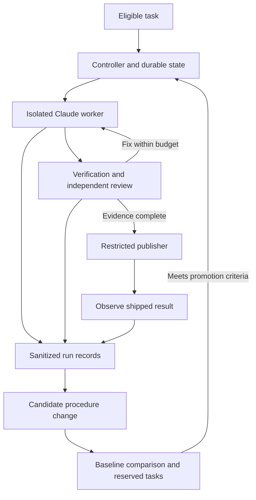

# Autonomous development implementation roadmap

Status: in progress. Milestone 1 is partly delivered (run-record schemas and a
first baseline from public GitHub data); the other milestones are proposed, not
implemented. Baseline inspection: 2026-10-13, commit `dd0fcf7`. Update milestone
status with implementation PRs and validation evidence as work lands.

The objective is to make GymCoach's autonomous maintenance reproducible,
measurable, and capable of testing improvements to its own working methods.
Claude remains the primary coding engine. Start with the existing skills and
verification scripts; add infrastructure only where it resolves an observed gap.

This plan does not change the [autonomy charter](07-autonomy.md) or
[external contribution policy](10-external-contributions.md). Implementation and
publication remain subject to their authority boundaries and any explicit
operator instructions. A roadmap item is not permission to bypass them.

## Baseline and gaps

The repository already has implementation, triage, shipping, ideation, and
documentation skills; a local verification gate; CI with integration, browser,
and Docker checks; isolated verification scripts; and a substantial incident log.

The next iteration should address these concrete gaps:

- Orchestration is described in prompts and Markdown. There is no committed
  standalone controller with durable transitions, task leases, or budget accounting.
- Limits and many safety checks depend on the executing agent following prose.
  Committed Claude settings do not provide lifecycle hooks enforcing the full policy.
  Global settings and GitHub protection rules need separate inspection.
- The shipping skill explicitly pins external merges to the reviewed SHA, while
  its loop-authored merge command does not carry the same pin.
- Shared-checkout incidents recur despite documented worktree rules (L15, L38).
- Lessons change procedures without a benchmark demonstrating an improvement.
- Software tests do not measure the maintainer's reliability, cost, or need for
  human intervention across repeated tasks.
- Documentation contains historical assumptions. For example, `bypassPermissions`
  and Claude's classifier-based auto mode are different mechanisms.

## Proposed architecture

Keep the maintenance runtime separate from the workout application. A proposed
layout is `automation/` for the controller, policies, runner adapters, and schemas;
`evals/maintainer/` for task fixtures and graders; and this directory for public
documentation. These paths do not exist as delivered capabilities yet.

Use a small TypeScript controller with a Claude Agent SDK adapter. The existing
Claude CLI can remain an adapter during migration. Start with SQLite for durable
state on one controller host. Revisit orchestration frameworks or distributed
storage only when recovery or deployment requirements justify them. Confirm the
chosen runtime's authentication and usage model before unattended execution.



The worker proposes code. The controller owns state and limits. The publisher
owns the narrow capability to publish or merge eligible results. The evaluator
checks outcomes independently. A candidate improvement cannot edit the policies,
grading code, or reserved evaluation data that determine its own acceptance.

## Milestone 1 Record a measurable baseline

- [x] Define versioned task, run, review, and outcome schemas.
      Evidence: [`automation/records/schema.ts`](../../automation/records/schema.ts),
      tested in [`automation/records/schema.test.ts`](../../automation/records/schema.test.ts)
      and [`automation/baseline/build.test.ts`](../../automation/baseline/build.test.ts).
- [ ] Record task ID, source provenance, base/head SHA, stage, attempts, timestamps,
      runner/model configuration, skill version, verification evidence, and outcome.
      Partial: reconstructed after the fact from GitHub per PR head
      ([`automation/baseline/`](../../automation/baseline/)); the model comes from
      commit trailers, and in-session attempts are unknown until the runner records
      them at run time. Models and skill version of the attributed subagent sessions
      are recovered from local transcripts by
      [`automation/usage/`](../../automation/usage/) (models for 32 of 79 runs, skill
      version for 3: only skills invoked through the Skill tool are identifiable).
- [ ] Record token usage, estimated cost, duration, cache usage where available,
      and human interventions. Mark unavailable values as unknown, never zero.
      Partial: [`automation/usage/`](../../automation/usage/) recovers tokens by kind
      (including cache reads and writes), an API-list-price cost estimate and summed
      session time from local Claude Code transcripts, for subagent sessions
      attributable to a PR by worktree head branch or a single PR reference (32 of 79
      runs, a lower bound per run, in
      [`baseline/2026-10-13/usage.jsonl`](baseline/2026-10-13/usage.jsonl), tested in
      [`automation/usage/build.test.ts`](../../automation/usage/build.test.ts)).
      Orchestrating sessions and unattributable subagents are totalled apart; human
      interventions stay unknown; runs before the retained transcripts stay unknown.
- [ ] Link post-merge regressions, reverts, and follow-up fixes to the originating
      run using a declared observation window. Count aborted and failed runs too.
      Partial: reverts and fix follow-ups (bug issues and fix PRs that cite the PR)
      are linked by heuristic within the window and reported over complete windows,
      with observing runs apart; closed-unmerged PRs are counted; work abandoned
      before a PR opened is invisible.
- [x] Capture a baseline using the current workflow before optimizing it.
      Evidence: [`baseline/2026-10-13/report.md`](baseline/2026-10-13/report.md)
      (79 PR runs since 2026-08-14). Limits: reconstructed after the fact; agent usage
      is known only where transcripts were retained and attributable (34 runs);
      human interventions are unknown for every run.

Store task state and artifacts outside mutable worker checkouts. Export sanitized
JSON/JSONL and a concise report; keep credentials, personal training data, and raw
private conversations out of public artifacts. Tool events, outputs needed for
verification, and concise decision summaries are sufficient; do not depend on
access to hidden model reasoning.

Acceptance: one run can be traced from task to reviewed commit and outcome; a
report distinguishes unknown costs and unfinished observation windows; a failed
run appears alongside successful runs. Record configuration versions so results
remain attributable after a model or skill upgrade.

## Milestone 2 Enforce execution and publication controls

- [ ] Implement durable states such as queued, claimed, implementing, verifying,
      reviewing, ready, merged, observing, completed, blocked, and failed.
- [ ] Allocate a worktree and disposable test environment per worker. Give each
      reviewer a read-only snapshot or its own isolated environment.
- [ ] Use task leases with heartbeat, expiry, and a generation token so a resumed
      stale worker cannot publish after another worker has claimed the task.
- [ ] Reconcile external actions after crashes. Use stable operation IDs and
      GitHub state to avoid duplicate PRs, comments, and merge attempts.
- [ ] Enforce total duration, spending, turns, retries, and concurrency limits,
      including delegated work. Define a bounded in-flight overrun allowance and
      stop dispatching before the remaining budget is exhausted.
- [ ] Keep deployment credentials and unrestricted GitHub tokens out of worker
      environments. Restrict filesystem access and network destinations. Use scoped
      publishing operations rather than arbitrary shell access with a merge token.
- [ ] Apply policy from a trusted version outside the candidate checkout. Inspect
      actual repository rules and configure required checks and branch protection
      through the appropriate maintainer authorization path.
      Partial: the rules are read on every merge
      ([`automation/publish/merge.ts`](../../automation/publish/merge.ts)). Today the
      `protect-main` ruleset blocks deletion and force-push, requires a PR (0
      approvals) and requires the five CI checks from GitHub Actions, with
      `strict_required_status_checks_policy: false` (a PR need not be up to date with
      `main`); classic branch protection is not set. The `ship-pr` skill runs the gate
      from a detached worktree of freshly fetched `origin/main`, not from the
      candidate's checkout, and `automation/**` is a human-merge-only path for external
      PRs; the trusted copy is still the last merged `main`, by procedure rather than a
      separate trusted host. Changing the ruleset is a maintainer decision.
- [x] Require a complete allowlisted set of successful CI checks and independent
      review evidence for the exact head SHA. Empty, missing, pending, or unrelated
      checks never count as success. Bind reviews to the base as well as the head.
      Evidence: the merge gate
      ([`gate.ts`](../../automation/publish/gate.ts), tests in
      [`gate.test.ts`](../../automation/publish/gate.test.ts)) requires every
      allowlisted check, from the pinned CI app and a single check suite, to have
      succeeded on the exact SHA; empty, missing, pending, skipped, neutral,
      foreign-app, second-suite and other-SHA checks refuse the merge, and so does an
      allowlist or app that disagrees with the repository's required checks. It also
      requires a structured review record ([`automation/review/`](../../automation/review/),
      tests in [`comment.test.ts`](../../automation/review/comment.test.ts) and
      [`record.test.ts`](../../automation/review/record.test.ts)) posted by a maintainer
      account (pinned numeric user ids) for the approved head and the PR's current base
      SHA; the latest record of every reviewer (kind, model and lens set) must be ready
      with no blocking or major finding, so one lens cannot clear another's stop.
      "Base" is GitHub's `base.sha` for the PR: it moves with a push or a rebase, not
      when `main` merely advances, which is the next item's job. Caveat: the gate
      proves review evidence for the exact commits exists, not that the review was
      independent; the loop posts its records from the same account that authors its
      PRs, so independence still rests on procedure (a separate reviewer agent).
- [ ] Pin every merge to the approved head, including maintainer-authored PRs.
      When the base changes, validate the new combined result before merging, through
      a merge queue or an equivalent serialized integration check.
      Partial, pin delivered: every merge in the
      [`ship-pr` skill](../../.claude/skills/ship-pr/SKILL.md) goes through the gate
      with `sha=<reviewed head>`, loop-authored PRs included. A base update is not yet
      revalidated mechanically (lesson L39 is still a procedure).
- [x] Bootstrap the test database and migrations automatically; retire procedural
      workarounds once the scripts enforce their intent.
      Evidence (PR #441): [`scripts/test-db.sh`](../../scripts/test-db.sh) starts, waits
      for (TCP readiness) and migrates the test Postgres inside the `verify.sh --full`
      lock, under one pinned compose project shared by every checkout, behind a URL
      guard self-tested by [`scripts/test-db.test.sh`](../../scripts/test-db.test.sh)
      (15 cases). Validated on 2026-10-13 with Docker running: `verify.sh --full` from
      a wiped container applied 28 migrations and passed unit (1376), integration (372)
      and E2E (23); a second fresh worktree reused the same container ("No pending
      migrations") and passed integration (372); a container left by another compose
      project was replaced and migrated. The manual step is retired from `CLAUDE.md`,
      `implement-issue` and `ship-pr`. Two earlier `--full` runs failed only at E2E with
      `ERR_INSUFFICIENT_RESOURCES` while the host ran several agents at once (load ~20),
      which is a concurrency-limit problem for the items above, not a bootstrap one.

Acceptance: simulate a crash immediately after PR creation, lease expiry with a
stale worker, concurrent task claims, budget exhaustion, absent CI checks, a push
after review, and a base update. Recovery must not duplicate side effects, reuse
stale approval, or grant additional authority. Worker code must not be able to
change the controller's policy or read publisher credentials.

Pause further autonomous shipping when post-merge verification detects a real
regression. Record the affected deployment and propose the appropriate recovery;
a Git tag alone does not restore database state. Keep data recovery and reserved
changes within the charter.

## Milestone 3 Evaluate the maintainer on repeatable tasks

- [ ] Start with a small smoke suite, then grow to approximately 20-30 historical
      and synthetic tasks with frozen starting snapshots and explicit acceptance criteria.
- [ ] Include code corrections, UI behavior, migration handling, CI diagnosis,
      interruption recovery, untrusted instructions, and review/merge races.
- [ ] Run baseline and candidate configurations in equivalent disposable
      environments. Pin dependencies and record infrastructure failures separately.
- [ ] Use independent acceptance tests and outcome checks. Keep grading code and
      reserved fixtures outside the worker's writable and readable task environment.
- [ ] Remove answer leakage from future Git history, lesson files, solution PRs,
      and network access during historical replay. Disclose any remaining contamination.
- [ ] Separate development, validation, and reserved test tasks by issue or failure
      family. Do not tune on the reserved set or repeatedly use it to select candidates.
- [ ] Repeat trials. Publish trial counts, variability, task-level outcomes, cost
      per successful task, interventions, and policy violations.
- [ ] Provide a documented replay command that requires no production credentials
      and cannot publish to the real repository.

Acceptance: the runner reproduces a known defect, rejects an intentionally
incomplete fix, accepts a correct fix, and verifies preserved behavior. Include
red-before/green-after checks or targeted mutation checks where they demonstrate
that a test detects the defect. Infrastructure errors and invalid model output
must remain visible rather than being silently removed from the denominator.

Use the small suite for fast iteration. Run the broader, repeated evaluation when
promoting a model, skill, routing, or controller change. Set a budget before paid
evaluations; report the limitations of a small sample.

## Milestone 4 Make reviews and memory actionable

- [ ] Produce structured review results: base/head SHA, scope inspected, unread
      scope, severity, reproducible evidence, and verdict. Missing coverage is explicit.
      Partial: the review record ([`schema.ts`](../../automation/review/schema.ts))
      carries base and head SHA, lenses, files inspected, files not read in full,
      findings with severity, file, line and claim, and the verdict; a ready verdict
      cannot carry a blocking or major finding, and a fixup or rebase makes the record
      stale for the merge gate. Reproducible evidence per finding (a command or test
      that shows the defect) is not a field yet.
- [ ] Keep reviewer context independent of the author's conversation. Supply the
      requirement, relevant code, diff, and verification evidence.
- [ ] For changed user flows, run an independent browser check against a seeded
      instance and retain relevant screenshots or Playwright traces.
- [ ] Route review lenses using changed surfaces and policy. Evaluate a different
      reviewer model as an experiment rather than assuming diversity guarantees quality.
- [ ] Index lessons by failure class, affected paths, incident, active procedure,
      and verification. Retrieve relevant lessons on demand; archive superseded guidance.
- [ ] Convert recurring mechanical lessons into scripts or tests. Resolve conflicts
      between skills and historical prose, including worktree lifecycle and permission modes.
      Partial: L42 (unit-tier timeouts under machine load, recurring since #219) became a
      formatter cache in [`lib/units.ts`](../../lib/units.ts) with a cache-key test and a
      worker cap in [`vitest.config.ts`](../../vitest.config.ts), with before/after timings
      in [L42](lessons.md); the other lessons are not yet reviewed for this.

Acceptance: a reviewer catches a seeded defect without the author's explanation;
fixups invalidate or refresh the relevant review evidence; a task retrieves the
relevant active lesson without loading the whole journal. Compare review benefit
and cost with the baseline before increasing the default reviewer count.

## Milestone 5 Test improvements to the agent's methods

- [ ] Add a bounded analysis job that proposes one skill, prompt, retrieval, or
      routing change from observed failures, with a stated hypothesis.
- [ ] Version each candidate and its lineage. Compare it with the current
      configuration on the evaluation suite under an explicit experiment budget.
- [ ] Define promotion criteria before seeing results: no new policy violations,
      acceptable regression behavior, and a useful quality/cost tradeoff.
- [ ] Keep the evaluator, protected policy, and reserved tasks beyond the
      candidate's authority. Record rejected candidates as well as accepted ones.
- [ ] Activate a winner on a limited set of eligible tasks, monitor outcomes,
      and retain the previous configuration for rollback.

Start with a manually specified comparison before automating candidate generation.
GEPA-style reflective optimization is a candidate method for prompts and skills;
the Darwin Godel Machine offers a broader research model for evolving agent code.
Neither establishes that unrestricted self-modification is appropriate here.

Acceptance: demonstrate one complete experiment from failure evidence to candidate,
comparison, and promotion or rejection. A rejected candidate is a valid result.
Claim improvement only with independent evidence, uncertainty, and the tested
scope stated. This changes the maintainer's methods, not Claude's model weights.

## Milestone 6 Evaluate Laya as an optional decision component

[Laya](https://github.com/NandhaKishorM/laya) produces typed classifications and
scores using small non-autoregressive models. It is a candidate for inexpensive
decisions around the coding agent, not a replacement for code generation or
complex review. Keep it optional and outside the application's default install.

- [ ] First compare simple rules, the existing Claude decision, and Laya on the
      same labeled tasks. Start with issue classification or review-lens suggestions.
- [ ] Run Laya in observation mode: log its prediction without changing actions.
- [ ] Record model/checkpoint revision, input length, truncation, hardware, cold
      and warm latency, resource use, accuracy, and confidence calibration.
- [ ] Measure false negatives for sensitive categories, abstention coverage, and
      total cost including fallback. A high confidence score alone is not authorization.
- [ ] Calibrate thresholds on validation data. Escalate uncertain, oversized,
      unsupported, or failed inputs to the established path.
- [ ] Promote only if measurable benefit justifies operating another component.
      Fine-tuning is a later experiment after enough representative labels exist.

Do not let Laya override path restrictions, grant permissions, certify a PR, or
authorize a merge. CI failure classification can assist diagnosis but cannot by
itself justify ignoring a failure or rerunning until green.

The published 33 ms latency is a T4 benchmark, not a promise for this deployment.
Context limits vary by checkpoint. The project's
[benchmark notes](https://github.com/NandhaKishorM/laya/blob/main/BENCHMARKS.md)
also describe calibration and reproducibility limitations and comparisons measured
under different conditions. Verify the chosen release on GymCoach data.

Acceptance: publish a reproducible comparison and an explicit integrate/defer
decision. No benefit at this repository's workload is a valid reason to defer.

## Product LLM improvements on a separate track

The AI coach and the development controller have different responsibilities.
Maintain separate configurations, credentials, datasets, and metrics.

- [ ] Evaluate coach behavior on synthetic profiles and histories, including
      missing data, units, program constraints, and inconsistent inputs. Existing
      prompt-string tests remain useful but do not measure generated behavior.
- [ ] Add schema-constrained generation where providers support it, while keeping
      Zod and domain checks before any change to saved training data.
- [ ] Extend provider results with usage, latency, and completion status, including
      streaming outcomes. Preserve provider differences and unknown values explicitly.
- [ ] Bound conversation context and separate stable instructions from changing
      training data to improve cache reuse without losing relevant information.
- [ ] Evaluate routing by task before replacing the single default model choice.

Acceptance: preserve provider contracts and user confirmation behavior; compare
answer quality and cost on the same fixtures before changing defaults. Follow
the charter for changes to permissions or the MCP security surface.

## Public evidence and contributor experience

- [ ] Publish sanitized aggregate results with definitions, sample sizes, versions,
      and links to reproducible runs. Distinguish unattended completion from assisted work.
- [ ] Add a short demonstration of issue, implementation, browser verification,
      review, and eligible merge using a controlled example.
- [ ] Keep the root README concise and this overview accurate as milestones ship.
- [ ] Reserve explicitly labeled issues for human contributors instead of letting
      the maintainer consume every `good first issue`.
- [ ] Tie ideation to reported needs and product evidence. Do not use commit count,
      generated issue volume, or stars as the optimization reward for the agent.

Success is useful changes delivered reliably, understandable evidence, and a
workflow others can reproduce. GitHub visibility is an outcome to observe, not a
reason to generate unnecessary work.

## Handoff prompt for Claude

```text
Read CLAUDE.md, docs/loops/README.md, docs/loops/07-autonomy.md,
docs/loops/10-external-contributions.md, and
docs/loops/11-autonomous-development-roadmap.md.

Implement this roadmap incrementally. Re-inspect the current repository and
runtime before assuming a proposed gap still exists. Start with the smallest
useful slice of Milestone 1: versioned run records and a sanitized baseline report
from verifiable data. Unknown measurements must stay unknown. Do not invent run
results or trigger an unbounded paid benchmark.

Choose one focused deliverable per PR, with acceptance criteria from the roadmap.
Preserve Claude as the primary coding engine and keep the maintenance runtime
separate from the app. Reuse the existing skills and verification scripts.
Use an isolated task branch/worktree and the checks appropriate to the change.
Before shipping non-trivial work, obtain the independent review required by the
charter. Follow existing authority boundaries for CI, permissions, publishing,
credentials, and policy changes; this roadmap does not broaden them.

Update milestone checkboxes only with implemented behavior and linked validation
evidence. Keep the overview and root README aligned with what actually ships.
Report the PR, validation, remaining limitations, and next dependent deliverable.
Do not introduce Laya, a framework migration, or self-modifying production policy
before the corresponding baseline and evaluation prerequisites exist.
```

## Technical references

- [Claude Agent SDK](https://code.claude.com/docs/en/agent-sdk/overview): programmable
  Claude execution, sessions, hooks, permissions, and structured results.
- [Anthropic agent evaluations](https://www.anthropic.com/engineering/demystifying-evals-for-ai-agents)
  (January 2026): outcome checks, traces, repeated trials, and grader calibration.
- [Anthropic application harness design](https://www.anthropic.com/engineering/harness-design-long-running-apps)
  (March 2026): separate generation and evaluation with browser verification.
- [Claude auto mode](https://www.anthropic.com/engineering/claude-code-auto-mode)
  (March 2026) and [sandboxing](https://www.anthropic.com/engineering/claude-code-sandboxing):
  action assessment and execution boundaries are distinct controls.
- [LangGraph persistence](https://docs.langchain.com/oss/javascript/langgraph/persistence):
  checkpointing and recovery concepts; not a required dependency.
- [GEPA](https://arxiv.org/abs/2507.19457) (revised February 2026): reflective prompt
  optimization using execution feedback.
- [Darwin Godel Machine](https://sakana.ai/dgm/): research on evaluated agent-code
  evolution, not an operational guarantee for this project.
- [Reflective prompt optimization evaluation](https://arxiv.org/abs/2610.12601)
  (October 8, 2026 preprint): reserved topics, repeated trials, and verifier
  comparisons in a research-agent setting; transfer to coding needs testing.
- [Claude structured outputs](https://platform.claude.com/docs/en/build-with-claude/structured-outputs):
  schema-constrained output for supported model/provider combinations.

Re-check provider APIs and upstream benchmark claims when implementing; these
references are design inputs, not proof of GymCoach's future results.
