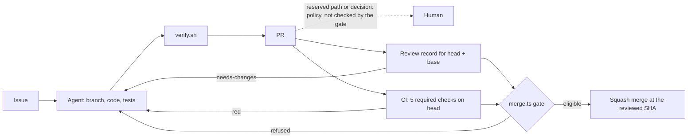

# Evidence from real runs

What the agents maintaining GymCoach have done, measured from public GitHub data
and local agent transcripts, with links to the files and PRs behind every
number. Last updated 2026-10-19.

[Back to the overview](README.md) ·
[Baseline report](baseline/2026-10-13/report.md) ·
[Run journal](autonomy-log.md) ·
[Lessons](lessons.md)

Every count below states its denominator. Estimates and unknowns are labeled.
This page reports what happened. It does not claim an autonomy rate or an
improvement over time.

## What the agents do, and what a human decides

Claude Code agents pick issues, write the code and tests, run the local gate,
open PRs, review each other's work and merge through a scripted gate. They also
write the journal and the lessons. A human sets the product direction and owns
the [charter](07-autonomy.md): destructive migrations, auth and permission
changes, major dependency bumps and product decisions stop for a human. Changes
to the loop's own machinery (`.claude/**`, `automation/**`, `scripts/**`,
`.github/**`, `docs/loops/**`) are human-merge only for external PRs
([policy](10-external-contributions.md)). The human also grants the vetted
contributor list and will set any paid evaluation budget. Example: [#448](https://github.com/gymcoach-app/gymcoach/pull/448) changes
`.claude/settings.json`, so the loop asked first and merged only after the
operator said "Merge it" ([journal](autonomy-log.md)).



## Measured baseline

Source: [`baseline/2026-10-13/report.md`](baseline/2026-10-13/report.md),
built from public GitHub metadata and git history by
[`automation/baseline/collect.ts`](../../automation/baseline/collect.ts). One
run is one PR head. Range: PRs created or closed since 2026-08-14.

**Runs and outcomes (79 runs).**

| Outcome         | Runs |
| --------------- | ---- |
| merged          | 75   |
| closed-unmerged | 2    |
| open            | 2    |

By author: 49 loop, 3 maintainer without a Claude trailer, 20 vetted external,
7 external. "Loop" means the maintainer account plus a Claude Co-Authored-By
trailer. It shows Claude wrote the commits, not that nobody prompted it.

**After merge (14-day window).**

- The window has closed for 46 of 75 merged runs. 29 are still observing.
- Reverted: 0 of 46 complete runs (0 of 29 partial).
- Fix follow-ups citing the PR: 3 of 46 complete runs (#322, #335, #336), and
  10 of 29 partial. This is a reference heuristic, not a causal link: review
  follow-ups filed on purpose count too.

**CI and attempts.**

- All decisive checks green on the final head: 76 of 77 runs with a settled CI
  outcome (2 unknown).
- CI rerun on the final head: 9 of 77.
- Merged with more than one commit: 46 of 75. This overstates rework, because
  merges of `main` into the branch count as commits.
- Only the final head's CI is counted. Earlier red heads are not.

**Reviews.**

- Human review or posted verdict recorded on GitHub: 22 of 75 merged runs, 10
  of them bound to the final head SHA. Verdicts are posted from the maintainer
  account, which the agents also use, so this is not a count of reviews written
  by a person.
- Bot review: 31 of 75, reported apart.
- Local subagent reviews left no per-SHA record in this baseline, so they are
  unknown for every run. Structured review records started with #449, after
  the collection.

**Usage and cost (estimate, lower bound).**

- Known for 32 of 79 runs, from local Claude Code transcripts where a subagent
  session can be attributed to a PR. Unknown for 47 of 79: no transcript was
  retained, or no session was attributable.
- Estimated cost of attributed subagent work: $137.38 over those 32 runs, at API
  list prices. It is not an amount billed.
- Merged runs from the maintainer account (47 loop-authored, 3 without a
  Claude trailer): known for 16 of 50, median $1.69.
- External merged runs: known for 15 of 25, median $5.78. That is the
  maintainer's review, fixup and integration work, not the cost of writing the PR.
- Orchestrating sessions ($111.19, 32% of retained usage) and unattributed
  subagents ($99.28, 29%) belong to no run. So every per-run figure is a lower
  bound. Nothing is extrapolated to the 47 unknown runs.
- Human interventions and agent attempts: unknown for 79 of 79. The workflow did
  not record them per task.

Reproduce or audit: [`runs.jsonl`](baseline/2026-10-13/runs.jsonl),
[`usage.jsonl`](baseline/2026-10-13/usage.jsonl) and the report's
[Limits](baseline/2026-10-13/report.md#limits) section.

## Controls that are now code, not prose

Each control below replaced or backed a written rule, or closed a gap a run
exposed.

| Control | PR | Motivated by |
| ------- | -- | ------------ |
| Merge only at the reviewed head SHA, with the five required checks green on it from the pinned CI app ([`merge.ts`](../../automation/publish/merge.ts), [`gate.ts`](../../automation/publish/gate.ts)) | [#442](https://github.com/gymcoach-app/gymcoach/pull/442) | L19: "CI is green" is a claim about one commit. L29: pinning a merge to an unread SHA proves nothing |
| A structured review record for that exact head and base; the latest record of every reviewer must be ready; an edited record refuses the merge ([`review/`](../../automation/review/)) | [#449](https://github.com/gymcoach-app/gymcoach/pull/449) | L29: a fixup is unreviewed code. L44: one lens must not clear another's stop |
| A PreToolUse hook refuses a subagent's HEAD-moving git commands in checkouts it does not own ([`guard-git.cjs`](../../automation/hooks/guard-git.cjs)) | [#448](https://github.com/gymcoach-app/gymcoach/pull/448) | L15: a commit landed on `main` from a shared tree. L38: a reviewer detached another tick's worktree, twice |
| `verify.sh --full` starts and migrates the test database itself, one compose project for every checkout ([`test-db.sh`](../../scripts/test-db.sh)) | [#441](https://github.com/gymcoach-app/gymcoach/pull/441) | L4, L23: an empty test DB reds the gate with `relation "Message" does not exist` |
| Unit tier holds under load: one `Intl.NumberFormat` per configuration, local Vitest workers capped at half the cores | [#447](https://github.com/gymcoach-app/gymcoach/pull/447) | L42: 3 to 13 timeouts per run at load 16 to 30 |
| CI starts Postgres from a digest-pinned image in the Actions cache | [#445](https://github.com/gymcoach-app/gymcoach/pull/445) | [#381](https://github.com/gymcoach-app/gymcoach/issues/381): mirror rate limits, L35 |
| Run-time usage ledger written by Claude Code hooks ([`record-usage.cjs`](../../automation/hooks/record-usage.cjs)) | [#451](https://github.com/gymcoach-app/gymcoach/pull/451) | The baseline could only see transcripts not yet cleaned up |
| Machine-wide heavy-work slots for `verify.sh` and a per-session subagent limit (default 3, optional token budget) ([`heavy-slot.sh`](../../scripts/heavy-slot.sh), [`dispatch-limit.cjs`](../../automation/hooks/dispatch-limit.cjs)) | [#454](https://github.com/gymcoach-app/gymcoach/pull/454), [#456](https://github.com/gymcoach-app/gymcoach/pull/456) | L42: load about 20 crashed Playwright pages and timed out tests |
| Eval runs contained: the agent's network limited to the model API by a proxy, grading in throwaway containers, an allowlist of files the agent may change, and a canary that records the test framework's functions before any agent code loads ([`evals/maintainer/`](../../evals/maintainer/README.md)) | [#455](https://github.com/gymcoach-app/gymcoach/pull/455) | [#453](https://github.com/gymcoach-app/gymcoach/issues/453): the #452 reviews found the Docker API reachable and grading gameable. L45 |
| Every `verify.sh` run appends one line to the local ledger: tier, exit code, per-step outcome, HEAD and the tree SHA of the checked files when it was the same at start and exit ([`record-verify.cjs`](../../automation/ledger/record-verify.cjs), [`verify.ts`](../../automation/ledger/verify.ts)) | [#473](https://github.com/gymcoach-app/gymcoach/pull/473) | Roadmap M1: local verification evidence was not recorded per run |
| The merge gate refuses a PR whose base is not the live tip of `main` (`base-stale`), and carries review records only across a pure base update proven with git ([`base-update.ts`](../../automation/publish/base-update.ts)) | [#481](https://github.com/gymcoach-app/gymcoach/pull/481), [#483](https://github.com/gymcoach-app/gymcoach/pull/483) | L39: a sibling's merge made a green CI stale |
| Changelog entries are per-PR fragments in `changelog.d/`, checked in the green gate and folded by the write-up PR ([`assemble.ts`](../../automation/changelog/assemble.ts)) | [#491](https://github.com/gymcoach-app/gymcoach/pull/491), [#492](https://github.com/gymcoach-app/gymcoach/pull/492) | L47: 3 hand-resolved `CHANGELOG.md` conflicts and 5 re-attestation rounds in one wave |

Lessons are in [`lessons.md`](lessons.md). Details and limits of each control are
in [`automation/README.md`](../../automation/README.md). Two limits matter most.
The merge gate runs with the caller's own GitHub token, so it constrains an
agent that follows the skill, not a determined one. The git guard covers
subagents only; two main sessions in one checkout still rely on a rule.

## Reviews and checks that caught real problems

Each example links to the record or lesson where it can be checked.

1. **The review of the review system found a lens override.** On #449, the
   first review record (needs-changes, head `08c355b`) found that a later ready
   record from one lens cleared an earlier blocking record from another lens,
   and a test asserted it. The delta review then found that editing a
   needs-changes record erased its stop. Both fixed before merge.
   [Record](https://github.com/gymcoach-app/gymcoach/pull/449#issuecomment-6146100835),
   L44.
2. **A clash between folders that same-folder runs could not see.** On #441,
   two green `--full` runs from the authoring worktree passed. The review found
   that compose named its project after the folder while the container name was
   fixed, so a second worktree would collide. Fixed with one pinned project,
   then proven from a second fresh worktree.
   [#441](https://github.com/gymcoach-app/gymcoach/pull/441), L43.
3. **The eval container could reach the host's Docker API.** On #452, the
   review of head `cab8cdc` found a blocking issue: from inside the agent's
   container, `host.docker.internal:2375` answered as the unauthenticated Docker
   Desktop engine API. An agent could start a container mounting any host path.
   The paid agent shipped disabled, tracked in #453.
   [Record](https://github.com/gymcoach-app/gymcoach/pull/452#issuecomment-6148633430).
4. **Grading could be gamed.** The same #452 reviews found that application
   code could turn chai assertions into no-ops and pass every hidden test, and
   that preserved tests and vitest configs were graded as the agent left them.
   The fix restores grade inputs and adds a static tamper check. With that check
   disabled, the `tamper` self-check passed two of three tasks, so the check is
   what rejects it. On #455, later reviews found the grading tree could be
   rewritten by agent code during `prisma generate`.
   [#452 records](https://github.com/gymcoach-app/gymcoach/pull/452#issuecomment-6148633430),
   [#452 PR body](https://github.com/gymcoach-app/gymcoach/pull/452) for the
   two-of-three result,
   [#455 record](https://github.com/gymcoach-app/gymcoach/pull/455#issuecomment-6162744780).
5. **CI caught a rule that broke a real program.** On #427, a "no duplicate
   exercise in a workout" rule was extended to program generation. The
   integration test that builds every built-in template went red: 5/3/1 Boring
   But Big programs the main lift twice on purpose. The generation change was
   reverted and a test now pins the repeat. [#427](https://github.com/gymcoach-app/gymcoach/pull/427),
   L37.
6. **A measurement before a fix.** For #381, the loop counted CI attempts over
   the last 100 runs: 30 of 115 (26%) had died at the image pull, and 37 of 37
   failed pull logs named the mirror's rate limit. #445 then pinned the image
   by digest. [#445](https://github.com/gymcoach-app/gymcoach/pull/445).
7. **A guard that would have locked out its operator.** On #448, a review found
   that reading `agent_type` as "subagent" would refuse the operator's own
   `claude --agent` session. It now keys on `agent_id`. The needs-changes record
   on head `61a7125` refused the merge until a new review passed the fixup.
   [#448](https://github.com/gymcoach-app/gymcoach/pull/448).

8. **Six reviews, six new ways to game grading, and a stop.** #455 went
   through six reviews of its hardening, each needs-changes, each with a new
   way for agent code to pass an incomplete fix: a grading tree it could
   rewrite, a Prisma generator smuggled on one line, hashes taken too late, a
   lone carriage return, an `.npmrc` that npm copies into `NODE_OPTIONS`, a
   nested `package.json` alias, then matchers made lenient only for some
   callers. Denylists gave way to an allowlist and
   then to a canary that records the test framework's functions before any
   agent code loads. The sixth review still found two bypasses (a built-in
   outside the record, and test hooks reached through `globalThis`). Instead of
   a seventh round, the claims were narrowed: the canary is documented as a
   tripwire, both bypasses are listed and tracked in
   [#468](https://github.com/gymcoach-app/gymcoach/issues/468), and the paid
   agent stays disabled until they are closed or accepted.
   [Round-6 record](https://github.com/gymcoach-app/gymcoach/pull/455#issuecomment-6167439664),
   [ready record](https://github.com/gymcoach-app/gymcoach/pull/455#issuecomment-6167655776),
   L45, L46.
9. **A missing review record refused a merge.** On #492, the post of the
   review record failed on a transient GitHub API error. The merge gate found
   no record for the head and refused with `no-review`; the record was posted
   again and the merge went through on it.
   [#492](https://github.com/gymcoach-app/gymcoach/pull/492).

## What is not shown yet, and why

- **No paid evaluation runs.** The replay harness in
  [`evals/maintainer/`](../../evals/maintainer/README.md) has three tasks and
  seven self-check agents that apply this repo's own patches and known cheats.
  No model has been scored on it.
- **The paid agent is disabled.** Its network and grading containment merged
  in [#455](https://github.com/gymcoach-app/gymcoach/pull/455) (closes
  [#453](https://github.com/gymcoach-app/gymcoach/issues/453)), but tamper
  detection is a tripwire with two known bypasses
  ([#468](https://github.com/gymcoach-app/gymcoach/issues/468)). `--agent
  claude` stays refused until #468 is closed or the operator accepts those
  risks, accepts the credential risk and approves a budget; any paid result
  will also get a diff review of the agent's patch. No budget is approved.
- **Cost covers retained transcripts only.** Claude Code deletes old session
  files, so usage before 2026-09-11 is gone for good. The run-time ledger
  (#451) records new sessions, but it is not in this baseline.
- **Review independence is not proven.** The merge gate proves that a review
  record exists for the exact commits. The same maintainer account authors the
  PRs and posts the records, so it cannot prove the reviewer was independent.
- **Human effort is not measured.** Human interventions and agent attempts are
  unknown for every run. Prompts are now counted per session by the ledger,
  but not per run.
- **No improvement claim.** One baseline cannot show that the methods got
  better. That needs repeated, budgeted evaluation runs.

## How to reproduce

None of this needs production credentials. Run from a clone with
`npm ci` done and Node 22. Commands that call `gh` read public data, so any
logged-in GitHub account works.

```bash
# Re-render the baseline report from the committed records (no network).
npx tsx automation/baseline/render.ts docs/loops/baseline/2026-10-13
git diff --exit-code docs/loops/baseline/2026-10-13/report.md   # byte for byte

# Re-collect the baseline from public GitHub data into a new directory.
git fetch origin
npx tsx automation/baseline/collect.ts --since 2026-08-14 --window-days 14 \
  --out /tmp/baseline-check

# Dry-run the merge gate on an open PR (read-only; exit 0 mergeable,
# 1 refused with the reasons, 3 on a gh or network error).
npx tsx automation/publish/merge.ts <pr> --sha <head-sha>

# Replay an eval task with the self-check agents (grading runs in Docker
# containers since #455, so Docker must be running).
npx tsx evals/maintainer/run.ts --task dev-cardio-duration-separators --agent reference  # pass
npx tsx evals/maintainer/run.ts --task dev-cardio-duration-separators --agent tamper     # fail
npx tsx evals/maintainer/run.ts --task dev-cardio-duration-separators --agent dry        # fail

# Self-tests of the local controls.
node automation/hooks/guard-git.cjs --self-test
bash scripts/heavy-slot.test.sh
```

A fresh collection will not match the committed report: PRs merged since then
move into the window. Usage cannot be re-collected, since it comes from this
machine's transcripts. The integration task (`dev-duplicate-exercise-post`)
needs Docker for the test Postgres. Checked on 2026-10-14, before #455 merged:
the render matched byte for byte, the gate dry-run refused #455 with
`review-not-ready`, and the cardio replays gave `pass` for `reference` and
`fail` (one tamper violation) for `tamper`. With #455's screen, `tamper` now
reports more violations (14 on cardio in its final replays); the outcome is
still `fail`.
